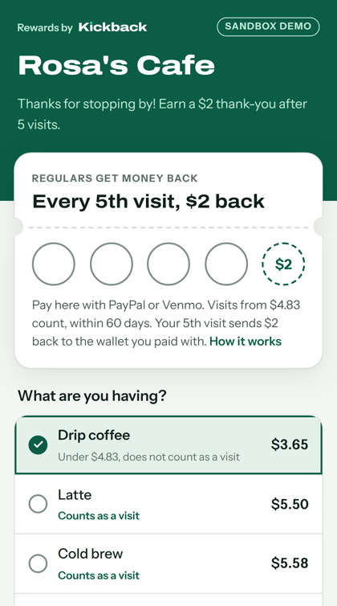
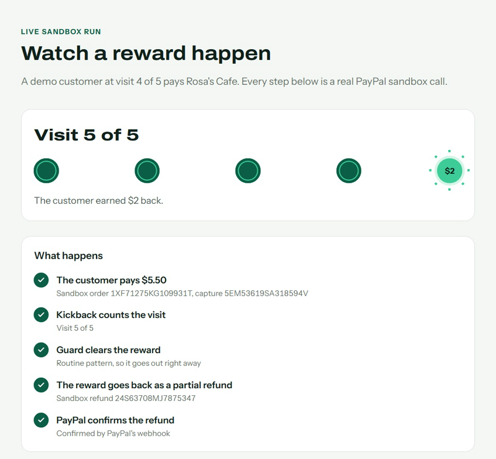
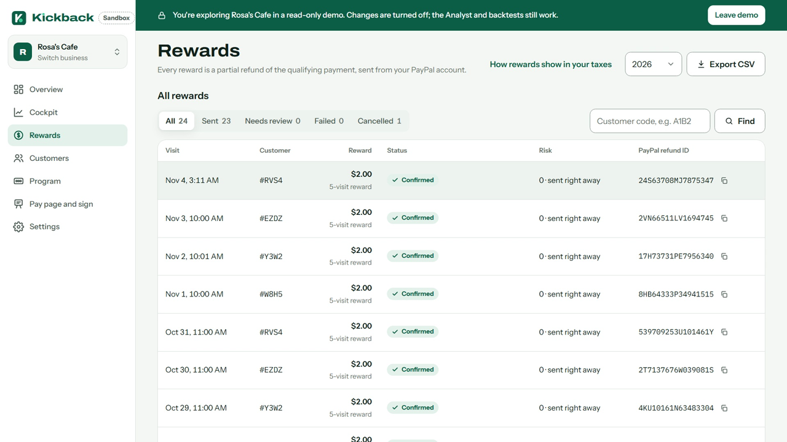
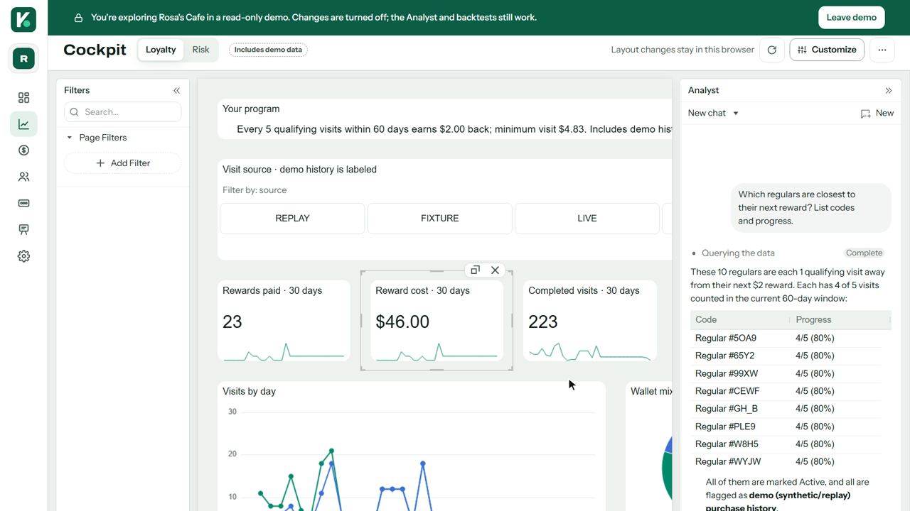
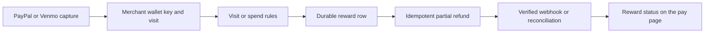

# Kickback

Payment-linked loyalty for small merchants on PayPal and Venmo.

Pay at a merchant, collect qualifying visits, and receive a thank-you partial refund when you earn a reward. Returning wallets are recognized without a separate customer account. The current deployment uses **sandbox accounts and test balances only**.

**[Try the demo](https://kickback-web.onrender.com/demo)** · [Service status](https://kickback-web.onrender.com/status) · [API documentation](https://documenter.getpostman.com/view/59031656/2sBYHSxfXm)

<p>
  
  
</p>

## Try it

Open the [demo page](https://kickback-web.onrender.com/demo) and pick one of three paths. Everything runs in PayPal sandbox with test balances.

- **Watch a reward happen** (no sign-in, about 45 seconds). A demo customer at visit 4 of 5 pays Rosa's Cafe through a saved sandbox wallet. You see the visit counted, Guard clear the reward, and the $2 partial refund go back with the note PayPal stored.
- **Pay as a customer** (about 3 minutes, phone or desktop). Get a demo buyer login on the demo page, open [Rosa's Cafe](https://kickback-web.onrender.com/pay/rosas), pick any item from $3.00 and pay with PayPal. Your purchase is the buyer's fifth visit, so the thank-you screen shows the reward. See [demo accounts](docs/demo-accounts.md).
- **Explore the merchant app** (read-only). Look around Rosa's Cafe, Bright Salon and Loaf Bakery as their owner sees them, including the Cockpit and its Analyst. Changes are turned off.

Five qualifying visits within 60 days earn $2 back; purchases within 120 minutes count as one visit. Read the [program terms](https://kickback-web.onrender.com/pay/rosas/terms). The [printable sign](https://kickback-web.onrender.com/pay/rosas/sign) and [QR image](https://kickback-web.onrender.com/api/pay/rosas/qr.png) point to checkout. [Service status](https://kickback-web.onrender.com/status) shows whether the demo is healthy. To try it with your own sandbox business, see [Bring your own sandbox business](docs/setup.md#bring-your-own-sandbox-business).

## Connect your business

Create a [merchant account](https://kickback-web.onrender.com/sign-up), add your business and time zone, then connect PayPal through merchant consent or your own REST app credentials. Kickback verifies the connection with PayPal before enabling payments. With Transaction Search enabled, it reads up to 90 days of sales and carries existing visit progress into your program without issuing rewards for milestones completed in history.

Activate a visit or spending preset, edit the menu, and download a pay sign or QR. The merchant area includes customer codes, rewards, limits, staff exclusion, and pause/resume controls. Disconnect stops checkout and future rewards immediately and schedules customer/payment data and connection credentials for deletion within 48 hours. Printed pay links lock after the first download.

Email/password sign-in works independently of email delivery. Password reset, verification, single-use sign-in links, and co-owner invitations require a configured email sender. Optional PayPal sign-in requires its separate callback configuration. See [setup](docs/setup.md).

<p>
  
  
</p>

## Cockpit

The merchant [Cockpit](https://kickback-web.onrender.com/m/cockpit) combines reward and visit KPIs, charts, customer codes, a review grid, a Reward Funnel and a Customer Ledger. Layouts and recent conversations are saved per business. Risk adds held/failed rewards, a weekday-by-wallet pivot and Analyst usage. Tool results appear inline in chat. Loyalty includes descriptive repeat-visit cohorts and an explicit measurement limit. The lightweight Overview remains available on every screen.

The Analyst reads the selected business's pseudonymous data and backtests proposed rules through scoped tools. It can arrange charts through AG Studio agents; it cannot approve rewards, refund purchases, message customers or activate programs. Anthropic keys stay on the server. Synthetic and replay history remain labeled. See [architecture](docs/architecture.md) and [AI behavior](docs/ai.md).

## Run locally

Use Node 24.21.0 (or >=22.12 and <25), npm, and Docker Desktop.

```powershell
npm ci
npm run env:init
# Fill platform credentials and demo merchant IDs in the private .env.
docker compose up -d --wait
npm run db:migrate
npm run seed:demo
npm run dev
```

Open http://localhost:3000/pay/rosas. See [setup](docs/setup.md) for authorization, environment variables, and Render configuration.

## Demo mode

`DEMO_MODE=true` with `KICKBACK_ENV=sandbox` enables protected replay tools. Save a sandbox wallet with the merchant's permission and keep its token private:

```powershell
npm run replay -- --merchant rosas --count 4 --amount 5.50 --vault <saved-wallet-token>
```

Rapid purchases merge normally. Add `--historical` for explicit sandbox visit fixtures on earlier days, allowing the next browser purchase to demonstrate a reward. Actual capture timestamps remain unchanged. Add `--remote https://your-app.onrender.com` and configure `REMOTE_JOBS_BEARER` to use the hosted database. Remote batches are limited to four purchases. These tools cannot run in live mode.

## How it works



### PayPal APIs used

| PayPal API | What Kickback does with it | Code |
|---|---|---|
| JavaScript SDK v6 (PayPal and Venmo) | Customer checkout on the pay page | `src/app/pay/[slug]/pay-client.tsx` |
| Orders v2 | Creates and captures each payment; the payer's wallet on the order becomes a merchant-specific HMAC key | `src/lib/payments/create.ts`, `src/lib/payments/capture.ts` |
| Payments v2 refunds | Sends each reward as a partial refund of the qualifying capture, with `note_to_payer` and a persisted `PayPal-Request-Id` | `src/lib/rewards/executor.ts` |
| Webhooks and signature verification | Captures, refunds, reversals and disputes update visits and rewards | `src/lib/paypal/webhooks.ts`, `src/lib/webhooks/dispatch.ts` |
| Partner Referrals v2 and `PayPal-Auth-Assertion` | Merchant consent; API calls run on the merchant's behalf | `src/lib/paypal/referrals.ts`, `src/lib/paypal/client.ts` |
| Transaction Search | Reads up to 90 days of sales for history, backtests and reconciliation | `src/lib/history/worker.ts` |
| Vault v3 setup tokens | Saved sandbox wallets for the demo customers behind "Watch a reward happen" | `src/lib/demo/vault.ts` |
| Server SDK (`@paypal/paypal-server-sdk`) | Order lookup | `src/lib/paypal/order-lookup.ts` |
| Log in with PayPal (optional) | Merchant sign-in | `src/lib/paypal/identity-profile.ts` |

The database commits a reward before an immediate background attempt. A five-minute worker recovers interrupted work. A unique reward per visit and persisted PayPal request IDs prevent duplicate payouts. Returned purchases cancel unpaid rewards or offset future rewards; disputes freeze eligibility. Merchant and global switches pause new refund attempts.

## Commands

```powershell
npm test
npm run typecheck
npm run lint
npm run build
npm run check:concurrency
npm run check:ledger
npm run jobs
npm run pause -- rosas
npm run resume -- rosas
npm run pause -- all
npm run webhook:register -- https://your-app.onrender.com
```

Tests cover calendar boundaries, identity, merging, budgets, offsets, executor errors, webhook replay, signatures, API tokens, and pacing. The concurrency check uses real sandbox Postgres and removes only its own generated rows.

## AI used and why

The Program Designer translates a merchant goal and aggregate history into three proposals. A deterministic backtest supplies the figures; explanations must pass a number-faithfulness check. Guard routes rewards by code-defined risk signals and gives owners a review queue. Scribe proposes validated notes, a terms introduction and a sign pitch. Owner approval is required before a proposal changes the active rule or public copy. No AI feature can move money.

Demo businesses can include labeled synthetic history for the design step. These visits are excluded from live eligibility and their captures can never be refunded. Without an API key, presets, template notes and deterministic Guard still work. See [AI behavior and limits](docs/ai.md).

## Integrations and privacy

PayPal Orders v2 creates and captures payments; Payments v2 issues refunds; Partner Referrals obtains merchant consent. The REST client caches OAuth tokens and uses priority lanes, a burst of 10 and a per-service refill (web 28, cron 12 and workflows 5 requests per minute, because PayPal's sandbox limits requests per IP); after a 429 it holds background work for five minutes. AG Studio provides the merchant Cockpit with labeled demo history; Anthropic powers validated program proposals, metric-grounded explanations and thank-you copy. Render hosts Next.js, Postgres, and the recovery worker.

The loyalty ledger stores merchant-specific HMAC keys and payment identifiers, never provider account IDs, names, email addresses, phone numbers, or Venmo usernames. This pseudonymous ledger remains linkable; it is not a claim of anonymity or a provider-policy exemption. Raw webhook payloads expire after 47 hours and are purged every five minutes, with alerts for retention over 48 hours. Production retention, consent, provider approvals, and deployment licenses must be established before live use. See [architecture](docs/architecture.md) and [privacy](docs/privacy.md).

## Try the API

[](https://god.gw.postman.com/run-collection/59031656-ce185f50-f841-445c-8319-1b0e14f75592?action=collection%2Ffork&source=rip_markdown&collection-url=entityId%3D59031656-ce185f50-f841-445c-8319-1b0e14f75592%26entityType%3Dcollection%26workspaceId%3Daa490361-c44d-4333-9d56-cb7ae64688be#?env%5Bkickback-sandbox%5D=W3sia2V5IjoicGF5cGFsX2Jhc2UiLCJ2YWx1ZSI6Imh0dHBzOi8vYXBpLW0uc2FuZGJveC5wYXlwYWwuY29tIiwiZW5hYmxlZCI6dHJ1ZSwidHlwZSI6ImRlZmF1bHQifSx7ImtleSI6ImNsaWVudF9pZCIsInZhbHVlIjoiWU9VUl9TQU5EQk9YX0NMSUVOVF9JRCIsImVuYWJsZWQiOnRydWUsInR5cGUiOiJkZWZhdWx0In0seyJrZXkiOiJjbGllbnRfc2VjcmV0IiwidmFsdWUiOiJZT1VSX1NBTkRCT1hfQ0xJRU5UX1NFQ1JFVCIsImVuYWJsZWQiOnRydWUsInR5cGUiOiJkZWZhdWx0In0seyJrZXkiOiJtZXJjaGFudF9pZCIsInZhbHVlIjoiWU9VUl9DT05ORUNURURfTUVSQ0hBTlRfSUQiLCJlbmFibGVkIjp0cnVlLCJ0eXBlIjoiZGVmYXVsdCJ9LHsia2V5IjoiYm5fY29kZSIsInZhbHVlIjoiWU9VUl9CTl9DT0RFIiwiZW5hYmxlZCI6dHJ1ZSwidHlwZSI6ImRlZmF1bHQifSx7ImtleSI6ImtpY2tiYWNrX2Jhc2UiLCJ2YWx1ZSI6Imh0dHBzOi8va2lja2JhY2std2ViLm9ucmVuZGVyLmNvbSIsImVuYWJsZWQiOnRydWUsInR5cGUiOiJkZWZhdWx0In0seyJrZXkiOiJzbHVnIiwidmFsdWUiOiJyb3NhcyIsImVuYWJsZWQiOnRydWUsInR5cGUiOiJkZWZhdWx0In0seyJrZXkiOiJraWNrYmFja19zZXNzaW9uIiwidmFsdWUiOiJQQVNURV9DT09LSUVfQUZURVJfU0lHTl9JTiIsImVuYWJsZWQiOnRydWUsInR5cGUiOiJkZWZhdWx0In0seyJrZXkiOiJvcmRlcl9pZCIsInZhbHVlIjoiWU9VUl9BUFBST1ZFRF9PUkRFUl9JRCIsImVuYWJsZWQiOnRydWUsInR5cGUiOiJkZWZhdWx0In0seyJrZXkiOiJjYXB0dXJlX2lkIiwidmFsdWUiOiJZT1VSX0NBUFRVUkVfSUQiLCJlbmFibGVkIjp0cnVlLCJ0eXBlIjoiZGVmYXVsdCJ9LHsia2V5Ijoic3RhcnRfZGF0ZSIsInZhbHVlIjoiMjAyNi0xMC0xNFQwMDowMDowMFoiLCJlbmFibGVkIjp0cnVlLCJ0eXBlIjoiZGVmYXVsdCJ9LHsia2V5IjoiZW5kX2RhdGUiLCJ2YWx1ZSI6IjIwMjYtMTAtMTVUMDA6MDA6MDBaIiwiZW5hYmxlZCI6dHJ1ZSwidHlwZSI6ImRlZmF1bHQifSx7ImtleSI6IndlYmhvb2tfaWQiLCJ2YWx1ZSI6IllPVVJfV0VCSE9PS19JRCIsImVuYWJsZWQiOnRydWUsInR5cGUiOiJkZWZhdWx0In0seyJrZXkiOiJwYXlwYWxfYXV0aF9hbGdvIiwidmFsdWUiOiJTSEEyNTZ3aXRoUlNBIiwiZW5hYmxlZCI6dHJ1ZSwidHlwZSI6ImRlZmF1bHQifSx7ImtleSI6InBheXBhbF9jZXJ0X3VybCIsInZhbHVlIjoiWU9VUl9PUklHSU5BTF9QQVlQQUxfQ0VSVF9VUkwiLCJlbmFibGVkIjp0cnVlLCJ0eXBlIjoiZGVmYXVsdCJ9LHsia2V5IjoicGF5cGFsX3RyYW5zbWlzc2lvbl9pZCIsInZhbHVlIjoiWU9VUl9UUkFOU01JU1NJT05fSUQiLCJlbmFibGVkIjp0cnVlLCJ0eXBlIjoiZGVmYXVsdCJ9LHsia2V5IjoicGF5cGFsX3RyYW5zbWlzc2lvbl9zaWciLCJ2YWx1ZSI6IllPVVJfVFJBTlNNSVNTSU9OX1NJR05BVFVSRSIsImVuYWJsZWQiOnRydWUsInR5cGUiOiJkZWZhdWx0In0seyJrZXkiOiJwYXlwYWxfdHJhbnNtaXNzaW9uX3RpbWUiLCJ2YWx1ZSI6IllPVVJfVFJBTlNNSVNTSU9OX1RJTUUiLCJlbmFibGVkIjp0cnVlLCJ0eXBlIjoiZGVmYXVsdCJ9XQ==)

Read the [published API documentation](https://documenter.getpostman.com/view/59031656/2sBYHSxfXm), or import the [Postman collection and placeholder environment](postman/README.md). Keep credentials and session cookies in local values.

## Tools used

The PayPal Context Plugin from APIMatic guided the server SDK order-lookup integration. Orders are read through `@paypal/paypal-server-sdk`; payment and refund execution retain the existing client. Render Workflows provides the optional reconciliation fan-out, with the five-minute cron as fallback.

## Security and live readiness

Responses include HSTS, nosniff, no-referrer, Permissions-Policy, popup-compatible COOP and frame protection. CSP is report-only; when configured, a first-party relay removes query strings before forwarding violations to Sentry. Private progress links expire and are rate-limited. Tokens are bearer links: anyone holding one can read its summary.

This is a sandbox demonstration, not a live-approved payments platform. Live use requires provider approval for the integration and reward model, operational and policy review, production credentials and licensing. See [live readiness](docs/live-readiness.md), [merchant reports FAQ](docs/merchant-faq.md) and [privacy](docs/privacy.md). Free in sandbox; no contract, no hardware, no customer app. Live pricing will be announced before launch.

## Team

Built by Varun Bhandari and Chaitanya Manik for the PayPal AI Hackathon, October–November 2026.

[MIT license](LICENSE)
