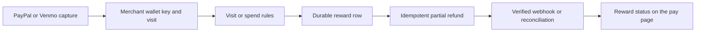

# Kickback

Payment-linked loyalty for small merchants on PayPal and Venmo.

Pay at a merchant, collect qualifying visits, and receive a thank-you partial refund when you earn a reward. Returning wallets are recognized without a separate customer account. The current deployment uses **sandbox accounts and test balances only**.

## Try it

Open [Rosa's Cafe](https://kickback-web.onrender.com/pay/rosas), choose a menu item or custom amount, and pay using a US PayPal sandbox buyer. The thank-you screen shows your progress. Five qualifying visits within 60 days earn $2 back; purchases within 120 minutes count as one visit. Venmo appears when the device and buyer are eligible.

Read the [program terms](https://kickback-web.onrender.com/pay/rosas/terms). The [printable sign](https://kickback-web.onrender.com/pay/rosas/sign) and [QR image](https://kickback-web.onrender.com/api/pay/rosas/qr.png) point to checkout.

## Run locally

Use Node 24.21.0 (or >=22.12 and <25), npm, and Docker Desktop.

```powershell
npm ci
npm run env:init
# Fill platform credentials and demo merchant IDs in the private .env.
docker compose up -d --wait
npm run db:migrate
npm run seed:demo
npm run dev
```

Open http://localhost:3000/pay/rosas. See [setup](docs/setup.md) for authorization, environment variables, and Render configuration.

## Demo mode

`DEMO_MODE=true` with `KICKBACK_ENV=sandbox` enables protected replay tools. Save a sandbox wallet with the merchant's permission and keep its token private:

```powershell
npm run replay -- --merchant rosas --count 4 --amount 5.50 --vault <saved-wallet-token>
```

Rapid purchases merge normally. Add `--historical` for explicit sandbox visit fixtures on earlier days, allowing the next browser purchase to demonstrate a reward. Actual capture timestamps remain unchanged. Add `--remote https://your-app.onrender.com` and configure `REMOTE_JOBS_BEARER` to use the hosted database. Remote batches are limited to four purchases. These tools cannot run in live mode.

## How it works



The database commits a reward before an immediate background attempt. A five-minute worker recovers interrupted work. A unique reward per visit and persisted PayPal request IDs prevent duplicate payouts. Returned purchases cancel unpaid rewards or offset future rewards; disputes freeze eligibility. Merchant and global switches pause new refund attempts.

## Commands

```powershell
npm test
npm run typecheck
npm run lint
npm run build
npm run check:concurrency
npm run jobs
npm run pause -- rosas
npm run resume -- rosas
npm run pause -- all
npm run webhook:register -- https://your-app.onrender.com
```

Tests cover calendar boundaries, identity, merging, budgets, offsets, executor errors, webhook replay, signatures, API tokens, and pacing. The concurrency check uses real sandbox Postgres and removes only its own generated rows.

## Integrations and privacy

PayPal Orders v2 creates and captures payments; Payments v2 issues refunds; Partner Referrals obtains merchant consent. The REST client caches OAuth tokens and uses priority lanes, a burst of 10, and a 40-per-minute refill per process. AG Studio provides a separate synthetic dashboard; Anthropic provides the Program Designer schema and SDK foundation. Render hosts Next.js, Postgres, and the recovery worker.

The loyalty ledger stores merchant-specific HMAC keys and payment identifiers, never provider account IDs, names, email addresses, phone numbers, or Venmo usernames. This pseudonymous ledger remains linkable; it is not a claim of anonymity or a provider-policy exemption. Raw webhook payloads expire after 47 hours and are purged every five minutes, with alerts for retention over 48 hours. Production retention, consent, provider approvals, and deployment licenses must be established before live use. See [architecture](docs/architecture.md) and [privacy](docs/privacy.md).

[MIT license](LICENSE)
